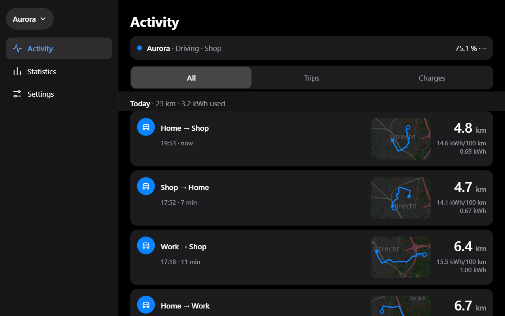
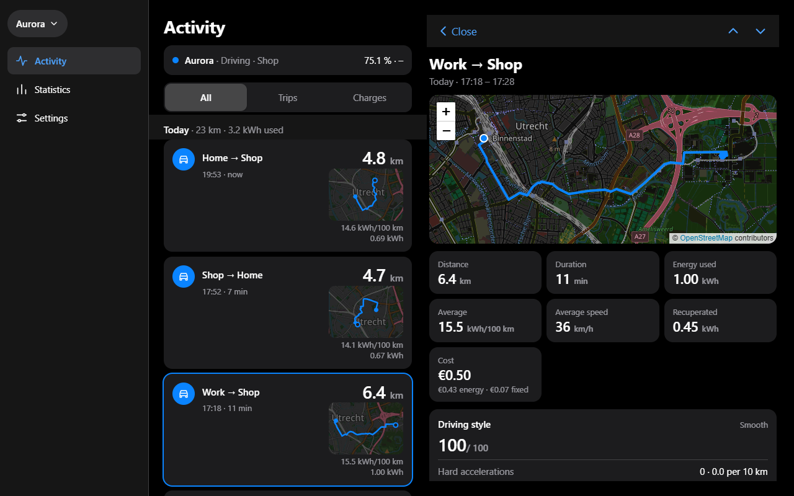
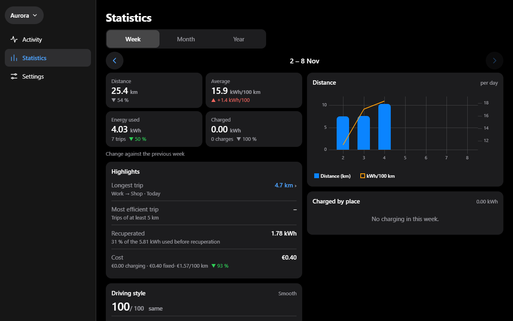

# Car Insights for Home Assistant

Car Insights records your car's trips, charges and costs in Home Assistant. It works for any car: from your car's own Home Assistant integration (Renault, Peugeot, Kia and more) or from an optional Android Automotive car app.

## What you get

- **Activity**: one timeline of your trips and charges, with route outlines and a page per trip or charge.
- **Statistics**: distance, energy and cost per week, month and year.
- **Costs**: your electricity prices, charge locations, card fees and fixed costs such as insurance.
- **Live sensors** in Home Assistant: charge level, range, plug, location and more, plus *Trip ended* and *Charge ended* events for automations.
- **Several cars and several people**: group cars for shared totals, and choose who sees which car.
- A **ready-made dashboard**.

## Requirements

Home Assistant 2026.9 or newer.

## Install

1. In HACS, open the menu (three dots, top right) > **Custom repositories**, add `https://github.com/misterblokhead/ha-car-insights` with type **Integration**, then download **Car Insights**.
2. Restart Home Assistant.
3. Click the button to add your first car:

Then follow [Getting started](docs/getting-started.md).

## Guides

- [Getting started](docs/getting-started.md): install, add your first car, the checklist.
- [Cars and data sources](docs/cars.md): your car's integration, the car app, which readings you need.
- [Costs](docs/costs.md): prices, charge locations, cost groups, fixed costs.
- [Sharing](docs/sharing.md): administrators, other users, groups.
- [Sensors and dashboard](docs/sensors-and-dashboard.md): live sensors, events, the dashboard.
- [Managing cars](docs/managing-cars.md): add, remove, archive, delete.
- [Troubleshooting](docs/troubleshooting.md): no data, repairs, backups, uninstalling.
- [Protocol](docs/protocol.md): for building your own sender.
- [Development](docs/development.md): running the tests and building the panel.

## Help

Found a bug or have a question? [Open an issue](https://github.com/misterblokhead/ha-car-insights/issues).

## License

MIT
